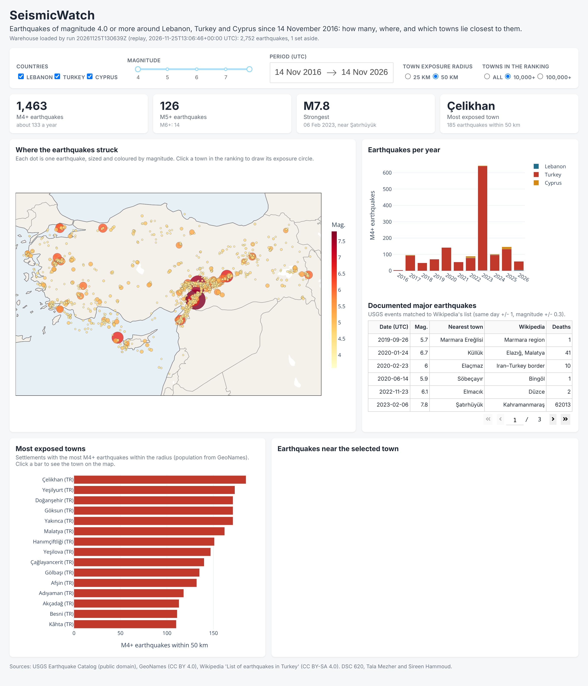
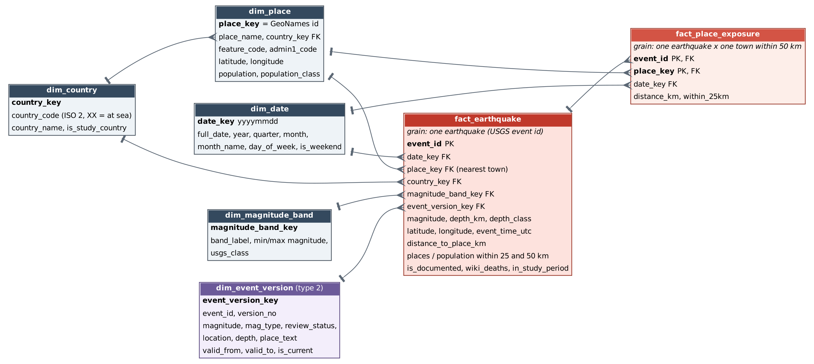

# SeismicWatch

**How often do earthquakes of magnitude 4 or more occur around Lebanon, Turkey and Cyprus, where, and
which populated places are closest to them?**

A data pipeline built for DSC 620 Data Engineering (Lebanese American University, Fall 2026) by
Tala Mezher and Sireen Hammoud. It pulls three sources, keeps the raw data untouched, cleans and tests
it, loads a star schema into SQLite and answers the question in a Dash dashboard.



## The answer, in short (14 Nov 2016 to 14 Nov 2026)

| | Turkey | Cyprus | Lebanon |
|---|---:|---:|---:|
| M4+ earthquakes | 1,417 | 41 | 5 |
| of which M5+ | 120 | 6 | 0 |
| strongest | M7.8 (6 Feb 2023) | M6.6 (11 Jan 2022) | M4.4 (22 Feb 2023) |

The 2023 Kahramanmaraş sequence alone gives 640 of Turkey's 1,417 earthquakes. The most exposed towns
of 10,000 people or more are Çelikhan (185 M4+ earthquakes within 50 km), Yeşilyurt, Doğanşehir, Göksun
and Yakınca; among large cities, Malatya (162), Adıyaman (118) and Kahramanmaraş (107). Details,
caveats and method: [docs/report.pdf](docs/report.pdf).

## Sources

| Source | Type | Access | What we use |
|---|---|---|---|
| [USGS earthquake catalogue](https://earthquake.usgs.gov/fdsnws/event/1/) | API (GeoJSON) | free, no key; max 20,000 events per query | every M4+ event in the box 32.5-42.5 N, 25.5-45.0 E since 14 Nov 2016; revisions through `updatedafter` |
| [GeoNames dumps](https://download.geonames.org/export/dump/) | files (zipped TSV, UTF-8) | free, CC BY 4.0, regenerated daily | `LB.zip`, `TR.zip`, `CY.zip` (every place) and `cities1000.zip` (towns of the neighbouring countries) |
| [Wikipedia: List of earthquakes in Turkey](https://en.wikipedia.org/wiki/List_of_earthquakes_in_Turkey) | web page (HTML tables) | CC BY-SA 4.0; robots.txt allows it | dates, magnitudes and deaths of historical earthquakes |

## Run it

Python 3.11 or newer.

```bash
git clone https://github.com/talamezher/seismicwatch.git
cd seismicwatch
python -m venv .venv
source .venv/bin/activate            # Windows: .venv\Scripts\activate
pip install -r requirements.txt
cp .env.example .env                 # then put your e-mail in SEISMICWATCH_CONTACT_EMAIL (sent in the User-Agent)

python run_pipeline.py               # first run: full extraction (about 1 minute), then transform, test, load
python dashboard/app.py              # open http://127.0.0.1:8050
```

Later runs of `python run_pipeline.py` are incremental (only events USGS changed since the last
watermark, with a one-day overlap). Other commands:

| Command | What it does |
|---|---|
| `python run_pipeline.py --full` | force a full USGS extraction |
| `python run_pipeline.py --skip-extract` | rebuild staging and the warehouse from the raw layer, no network |
| `python scripts/check_rerun.py` | rebuild twice and compare the warehouse fingerprints (idempotency proof) |
| `python scripts/run_report.py` | last runs, data tests, quarantine and joins, as Markdown |
| `python -m src.transform.profile` | profile the raw sources into `docs/profiling.md` |
| `pytest` | 36 unit and end-to-end tests |

Each run writes `logs/pipeline_<run id>.log` and one row in the `run_log` table. No source needs an
API key; `.env` (never committed) only holds the contact e-mail and optional settings.

## What happens in one run

1. **Extract** (`src/extract/`): one module per source, one polite HTTP client (User-Agent with contact,
   60 s timeout, 1 s between requests, retries with backoff on 429 and 5xx, never on other 4xx). USGS is
   paged by year window with a checkpoint; GeoNames uses `If-Modified-Since`; Wikipedia's robots.txt
   is read first. Every response is saved untouched in `data/raw/`, listed in `data/raw/manifest.jsonl`
   (URL, time, records, bytes, SHA-256).
2. **Stage** (`src/transform/staging.py`): one table per source (`stg_events`, `stg_places`,
   `stg_wiki_quakes`, saved as Parquet): rename, cast, standardize, placeholders to missing, newest
   version / duplicates, flag invalid rows.
3. **Test** (`src/quality/checks.py`): 27 data tests with a severity: quarantine (Q1-Q7, P1, K1),
   stop (S1-S5, R1-R7) or warn (W1-W6). Failing rows go to the `quarantine` table with their reason.
4. **Join and apply the rules** (`src/transform/enrich.py`, `rules.py`): nearest town, towns within
   50 km, Wikipedia matches, every join checked with `validate=` and a row count; six business rules,
   documented in [docs/business_rules.md](docs/business_rules.md).
5. **Load** (`src/load/`): star schema in `data/warehouse/seismicwatch.db`, idempotent upsert in one
   transaction, relationship tests before commit.
6. **Serve** (`dashboard/app.py`): map, earthquakes per year, most exposed towns, documented
   earthquakes and the events near a selected town.

## Data model



`fact_earthquake`: one row per earthquake (USGS event id). `fact_place_exposure`: one row per
earthquake and populated place within 50 km. `dim_event_version` keeps every version USGS published
of an event (type 2 slowly changing dimension).

## Extensions

- **Scheduling**: [.github/workflows/daily.yml](.github/workflows/daily.yml) runs the pipeline every day
  at 03:17 UTC; `data/` is kept between runs in the Actions cache, and each run adds a row to `run_log`.
- **Continuous integration**: [.github/workflows/ci.yml](.github/workflows/ci.yml) runs the unit tests
  and an end-to-end run, twice, on a sample of real raw records (`tests/fixtures/raw`) on every push.
- **History** (bonus): `dim_event_version` is a type 2 dimension of USGS revisions.

## Layout

```
run_pipeline.py          one command: extract, transform, test, load
src/extract/             usgs.py, geonames.py, wikipedia.py, http.py (polite client), manifest.py
src/transform/           staging.py, enrich.py (joins), rules.py, geo.py, profile.py
src/quality/             checks.py (data tests, severities, quarantine)
src/load/                schema.sql, warehouse.py
dashboard/               app.py, queries.py, assets/ (styles, map outlines)
tests/                   pytest; fixtures/raw is a sample of real raw files
scripts/                 check_rerun.py, run_report.py, make_fixtures.py
docs/                    report.pdf, slides.pdf, diagrams/, business_rules.md, profiling.md, img/
```

## Credits and licences

Earthquake data: U.S. Geological Survey, ANSS Comprehensive Catalog (public domain). Places: GeoNames
(geonames.org), CC BY 4.0. Historical list: Wikipedia contributors, "List of earthquakes in Turkey",
CC BY-SA 4.0. Map outlines: Natural Earth, through plotly.js.
